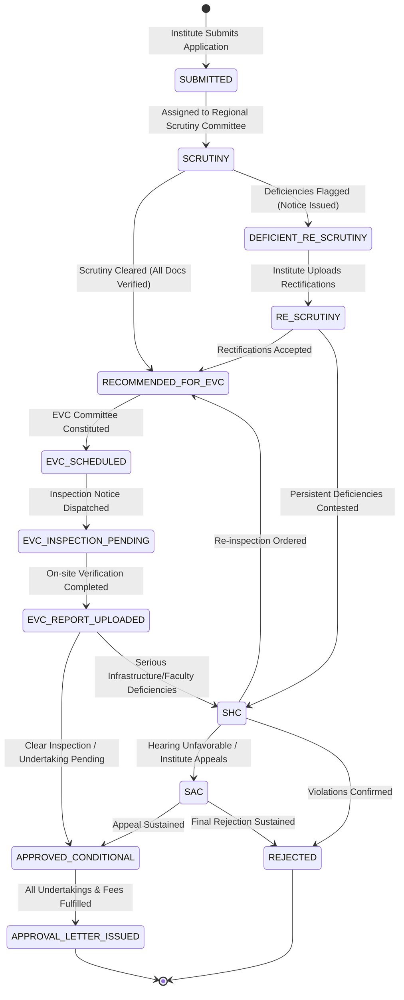

# SAKSHAM — Technical Architecture Specification
## AICTE Approval Workflow & Compliance Management System

---

### 1. High-Level System Architecture

SAKSHAM is structured as a modular, TypeScript-first web platform engineered for reliability, traceability, and government-grade usability.

```
+-----------------------------------------------------------------------------------+
|                                  USER LAYER                                       |
|  AICTE Scrutiny Officers | Regional Officers | EVC Experts | SAC/SHC | Bureau HQ  |
+-----------------------------------------------------------------------------------+
                                         |
                                         v
+-----------------------------------------------------------------------------------+
|                           FRONTEND APPLICATION (Client)                          |
|  - React 18/19 + Vite + TypeScript                                                |
|  - Tailwind CSS + Vanilla Administrative Design Tokens                            |
|  - React Router v6+ for Stage & Queue Navigation                                  |
|  - Lucide React (Official Administrative Icons)                                    |
|  - Recharts (Workload, Ageing & Regional Distribution Visuals)                    |
|  - Framer Motion (Restrained, Purposeful Micro-transitions)                       |
|  - React Hook Form + Zod (Strict Client-side Validation)                          |
+-----------------------------------------------------------------------------------+
                                         |
                                         | JSON / HTTPS (REST API)
                                         v
+-----------------------------------------------------------------------------------+
|                            BACKEND API SERVICE (Server)                           |
|  - Node.js + Express + TypeScript                                                 |
|  - Modular Layers: Routes -> Controllers -> Services -> Repositories              |
|  - Health & Readiness Probes (/api/health, /api/health/ready)                     |
|  - Zod Request Schema Validation & Custom Error Handling Middleware               |
|  - Audit Logging Middleware (Immutable Forensic Interceptor)                      |
|  - Synthetic Fixture Adapter (Phase 1) <-> Prisma PostgreSQL Adapter (Phase 2)    |
+-----------------------------------------------------------------------------------+
                                         |
                                         | SQL Connection Pool (Prisma Client)
                                         v
+-----------------------------------------------------------------------------------+
|                             DATABASE LAYER (PostgreSQL)                           |
|  - PostgreSQL 16 (Containerized via Docker Compose)                              |
|  - Prisma ORM Data Modeling & Automated Migrations                                |
|  - Entities: Applications, Stages, EVC, Compliance, Documents, Audits, Rules      |
+-----------------------------------------------------------------------------------+
```

---

### 2. Repository & Workspace Layout

```
SAKSHAM/
├── client/                     # Vite + React + TypeScript Frontend
│   ├── public/                 # Static assets & favicon
│   ├── src/
│   │   ├── components/         # Shared UI components (Layout, Table, Badge, Modal, etc.)
│   │   ├── data/               # Deterministic synthetic fixtures matching DB schema
│   │   ├── hooks/              # Custom React hooks (navigation, filters, metrics)
│   │   ├── pages/              # 10 Route page components
│   │   ├── services/           # API client layer (switchable between mock & server)
│   │   ├── types/              # Frontend-specific types (or re-exported from shared)
│   │   ├── utils/              # Formatting, ageing calculation, styling helpers
│   │   ├── App.tsx             # Main routing & layout shell
│   │   ├── index.css           # Tailwind directives & administrative design tokens
│   │   └── main.tsx            # Entry point
│   ├── package.json
│   ├── tsconfig.json
│   ├── vite.config.ts
│   └── tailwind.config.cjs
├── server/                     # Node.js + Express + TypeScript Backend
│   ├── src/
│   │   ├── controllers/        # Express route handlers
│   │   ├── middleware/         # Error handler, audit logger, Zod validator
│   │   ├── routes/             # REST endpoints (/health, /applications, /rules, etc.)
│   │   ├── services/           # Business workflow & ageing logic
│   │   ├── types/              # Server-specific types
│   │   └── app.ts / server.ts  # Express app configuration & server bootstrap
│   ├── prisma/
│   │   └── schema.prisma       # Relational models for PostgreSQL
│   ├── package.json
│   └── tsconfig.json
├── shared/                     # Cross-layer Type Definitions & Enums
│   ├── src/
│   │   └── index.ts            # Application, Stage, EVC, Compliance, Rule interfaces
│   ├── package.json
│   └── tsconfig.json
├── docs/                       # Project Documentation
│   ├── PROJECT_CHARTER.md
│   ├── ARCHITECTURE.md
│   ├── SOURCE_REGISTER.md
│   ├── REGULATORY_RULES_REGISTER.md
│   └── IMPLEMENTATION_ROADMAP.md
├── docker-compose.yml          # PostgreSQL 16 Container Setup
├── .env.example                # Clean environment variables template
├── .gitignore
├── package.json                # Root package with npm workspaces
└── README.md                   # Setup, verification, and developer guide
```

---

### 3. Application Workflow State Machine

The life-cycle of an AICTE application transitions through statutory stages based on the AICTE Approval Process Handbook (APH):



---

### 4. Relational Database Design (Prisma / PostgreSQL)

1. **`Application`**: Core master record capturing Institute Permanent ID, Application ID, Academic Year, Application Category, Current Stage, Regional Office, Status, Total Ageing Days, Stage Ageing Days, and Submission Timestamp.
2. **`ScrutinyFinding`**: Stage-wise checklist items (e.g. Land Document Validity, Building Plan Approval, Fire NOC, AICTE-to-AICTE Land Title, Faculty Ratio) with verified flag, deficiency remark, and verification officer.
3. **`EVCInspection`**: Physical/hybrid committee visit scheduling, committee member list, proposed inspection date, actual inspection date, geo-coordinates, report submission status, and recommendation flag.
4. **`ComplianceItem` (Undertakings)**: Time-bound commitments submitted by institutions (e.g. appointment of Principal, renewal of fire NOC within 90 days, land conversion mutation), due date, reminder count, status (ACTIVE, SUBMITTED, VERIFIED, OVERDUE), and penalty escalation notes.
5. **`DocumentValidityRecord`**: Document type (Land Lease, Fire Safety NOC, Building Occupancy, NBA Accreditation, Fixed Deposit Receipt / FDR), issuance date, expiry date, issuing authority, renewal lead days, alert level (NORMAL, EXPIRING_SOON, EXPIRED, CRITICAL).
6. **`RegulatoryRule`**: Configurable rule engine representation storing rule code, category, requirement title, mandatory documents, legal handbook reference, SLA days, and escalation threshold.
7. **`AuditLog`**: Immutable append-only log capturing timestamp, actor ID, actor role, IP address, action type, entity affected, previous state, and new state.

---

### 5. Deterministic Fixture & Transition Architecture (Phase 1)
To guarantee rapid, testable, and completely reproducible behavior in Phase 1:
- The UI uses a rich, coherent synthetic dataset (`client/src/data/mockData.ts`) matching the exact Prisma schema types.
- The server exposes REST API endpoints that serve structured queries from this domain model.
- Every metric on the dashboard (overdue tasks, EVC counts, compliance notices, stage distributions) is derived dynamically from the same dataset. No hard-coded conflicting counts.
- Transitioning to full live database execution in Phase 2 requires only changing the repository adapter in the backend services.
