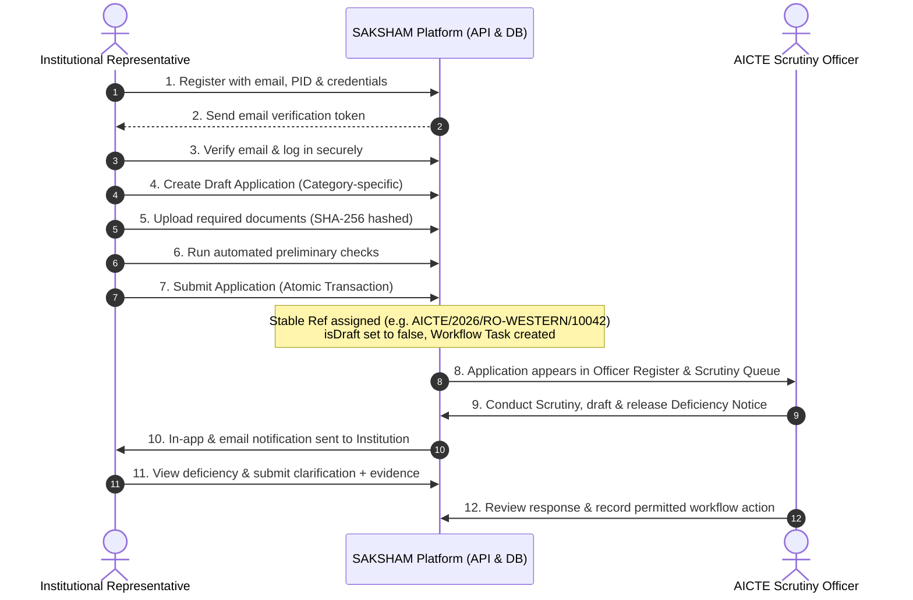

# SAKSHAM — Phase 3 Implementation Report
**AICTE Approval Workflow & Compliance Management System**  
**SIH Problem Statement:** 26262  
**Date:** October 2026  
**Status:** Completed & Verified  

---

## 1. Executive Summary

Phase 3 transitions SAKSHAM from an officer-only administrative prototype into a **complete two-sided digital governance platform**. Institutional representatives and AICTE officers now operate against the same unified backend, PostgreSQL database, authentication system, and workflow engine.

All operations—from institution registration, document uploads, and preliminary completeness checks to atomic application submissions, live officer queue processing, deficiency notices, and compliance undertakings—are fully persisted and verified.

---

## 2. Key Architecture & Database Schema Additions

### 2.1 Database Models (`server/prisma/schema.prisma`)

1. **`Institution`**
   - Stores authoritative institution identity: `name`, `trustName`, `permanentInstituteId` (PID), `state`, `district`, `pincode`, `contactEmail`, `contactPhone`, and verification status.
   - Enforces 1-to-many relationships with `SystemUser` and `Application`.
2. **`SystemUser`** (Extended)
   - Added `INSTITUTION_USER` role.
   - Added `institutionId` foreign key linking representatives to their authorized institution.
   - Secure fields: `passwordHash` (Argon2id), `tokenVersion`, `emailVerified`, `emailVerificationToken`, `emailVerificationExpires`, `resetPasswordToken`, `resetPasswordExpires`.
3. **`ApplicationDocument`**
   - Authoritative document vault model: `applicationId`, `documentType`, `title`, `fileName`, `fileSize`, `mimeType`, `storagePath`, `fileHash` (SHA-256 integrity hash), `verificationStatus` (`PENDING`, `VERIFIED`, `REJECTED`, `FLAGGED`), and `uploadedById`.
4. **`DeficiencyNotice`**
   - Two-way communication model: `applicationId`, `noticeReference`, `findingId`, `clauseRef`, `deficiencyText`, `remedialAction`, `deadline`, `status` (`DRAFT`, `RELEASED`, `RESPONDED`, `RESOLVED`), `responseNote`, `responseDocRef`, `responseSubmittedAt`, `issuedByName`, and timestamps.
5. **`Notification`**
   - In-app notification log: `userId`, `institutionId`, `type`, `title`, `message`, `linkUrl`, `read`.
6. **`Application`** (Extended)
   - Added `institutionId` foreign key for strict tenant isolation.
   - Added `isDraft` boolean (drafts are private to institutions and excluded from officer queues).
   - Generated stable SAKSHAM references (`AICTE/2026/RO-<REGION>/<SEQUENCE>`).

### 2.2 Migrations
- Migration `20261024165338_phase3_two_sided_platform` created and applied cleanly via Prisma.

---

## 3. Two-Sided Platform Route Structure

### 3.1 Institution Portal
- `/institution/login` — Dual-portal entry point with professional credentials authentication.
- `/institution/signup` — Public self-registration for institutional representatives.
- `/institution/verify-email` — Opaque cryptographic token verification.
- `/institution/forgot-password` & `/institution/reset-password` — Secure password recovery.
- `/institution/dashboard` — Authenticated institution dashboard with pending applications, deficiency alerts, and compliance deadlines.
- `/institution/applications` — Searchable register of all applications belonging strictly to the institution.
- `/institution/applications/new` — Multi-step draft creation and submission wizard.
- `/institution/applications/:id` — Detail view with stage tracker, uploaded documents, and deficiency resolution workflow.
- `/institution/documents` — Secure institutional document vault with SHA-256 verification hashes.
- `/institution/compliance` — Undertaking management and compliance evidence submission.
- `/institution/profile` — Verified institutional particulars and contact management.

### 3.2 AICTE Officer Portal (Preserved & Extended)
- `/dashboard` — Executive overview and pendency metrics.
- `/applications` — Central register (now displays live submitted applications from institutions).
- `/workflow-queue` — Actionable processing queue for Scrutiny and Committee officers.
- `/scrutiny` — Document checklist evaluation, deficiency drafting, and notice release.
- `/evc-management` — Expert Visit Committee scheduling and inspection reports.
- `/compliance` — Institutional compliance monitoring and evidence review.
- `/document-validity` — Tracking expiry of approvals, land titles, and building safety NOCs.
- `/regional-reports` — Workload and pendency breakdown across AICTE regional offices.
- `/alerts` — SLA breaches, high pendency, and escalation alerts.
- `/audit` — Immutable audit trail of every state-changing event.
- `/regulatory-rules` — Traceable APH 2024–27 rule administration.

---

## 4. End-to-End Workflow Verification

---

## 5. Security & Tenant Isolation

- **Authoritative Identity:** Every request resolves the institution from `req.user.institutionId` on the server. Request payload overrides are rejected.
- **Double-Submit CSRF:** State-changing requests validate `x-csrf-token` matching `saksham_csrf_token`.
- **Private Storage:** Document files stored in isolated local directory with UUID keys. No direct URL access without backend authorization.
- **Argon2id Hashing:** Industry-standard password hashing with timing attack mitigation.

---

## 6. Test and Build Summary

- **Server Test Suite:** 4 test files, **59 passed tests (100% green)**:
  - `server/src/__tests__/institution.test.ts` (22 tests)
  - `server/src/__tests__/auth.test.ts` (15 tests)
  - `server/src/__tests__/services.test.ts` (14 tests)
  - `server/src/__tests__/routes.test.ts` (8 tests)
- **Client Test Suite:** 1 test file, **8 passed tests (100% green)**.
- **Build Verification:** All workspaces (`@saksham/shared`, `@saksham/server`, `@saksham/client`) compiled with zero TypeScript errors.
