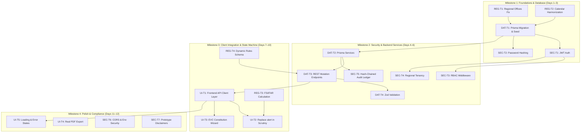

# SAKSHAM — Remediation Roadmap & Engineering Plan
## Prioritized Backlog by Severity, Dependencies & Regulatory Impact
**Project Name:** SAKSHAM  
**Subtitle:** AICTE Approval Workflow & Compliance Management System  
**SIH Problem Statement ID:** 26262  
**Planning Horizon:** Phase 2 (Implementation & Hardening)  

---

## 1. Top 5 Most Critical Remediation Tasks

The five most urgent remediation actions required before deploying or presenting the SAKSHAM system are:

```
+--------------------------------------------------------------------------------------------------+
|                              TOP 5 CRITICAL REMEDIATION TASKS                                    |
+----+---------------------------------------------------+--------------------+--------------------+
| No | Remediation Task                                  | Category           | Severity / Priority|
+----+---------------------------------------------------+--------------------+--------------------+
| 1  | Reconcile AICTE Regional Structure & Supreme Court| Regulatory & Data  | P0 - Blocker       |
|    | Deadlines (Add SCRO Hyderabad, Fix Parshvanath)   | Correctness        |                    |
+----+---------------------------------------------------+--------------------+--------------------+
| 2  | Implement True Backend Persistence via Prisma &   | Architecture & Data| P0 - Blocker       |
|    | PostgreSQL Migrations                             | Integrity          |                    |
+----+---------------------------------------------------+--------------------+--------------------+
| 3  | Implement Real JWT Authentication & Role-Based    | Security & Access  | P0 - Blocker       |
|    | Enforcement Middleware (RBAC)                     | Control            |                    |
+----+---------------------------------------------------+--------------------+--------------------+
| 4  | Replace Browser alert() Popups with Real Workflow | Functional Engine  | P1 - High          |
|    | State Transitions & API Mutation Endpoints        | & UI               |                    |
+----+---------------------------------------------------+--------------------+--------------------+
| 5  | Build Cryptographically Chained (Tamper-Evident)  | Forensic Security  | P1 - High          |
|    | Audit Trail Ledger                                | & Legal Compliance |                    |
+----+---------------------------------------------------+--------------------+--------------------+
```

### Detailed Rationale for Top 5 Tasks:
1. **Task 1 (Regional & Statutory Alignment):** Omitting South-Central Regional Office (SCRO, Hyderabad) invalidates the application for institutions across Andhra Pradesh and Telangana. Similarly, conflating AICTE's April 30 decision cutoff with university June 10 affiliation deadlines undermines regulatory credibility in front of AICTE evaluators.
2. **Task 2 (Prisma & PostgreSQL Persistence):** The system cannot advance beyond an interactive mockup until backend controllers actually query and mutate PostgreSQL tables rather than reading in-memory JavaScript fixtures.
3. **Task 3 (Authentication & RBAC):** Anyone can currently execute administrative tasks or switch roles without credentials. A government-grade portal requires real tokens, hashed credentials, and regional tenant isolation.
4. **Task 4 (Workflow State Machine):** Buttons that trigger browser `alert()` popups prevent real end-to-end evaluation. Real REST endpoints (`POST /api/applications/:id/scrutiny-findings`, `POST /api/evc/schedule`) must process actions and update application stages.
5. **Task 5 (Tamper-Evident Audit Ledger):** Problem statement 26262 and government regulatory norms demand forensic traceability. Plain database rows that can be silently edited or deleted fail the auditability mandate; cryptographic SHA-256 hash chaining guarantees non-repudiation.

---

## 2. Comprehensive Remediation Workstreams

---

### Workstream A: Regulatory Correctness & Statutory Alignment

| Task ID | Task Title | Description & Regulatory Grounding | Dependencies | Severity | Effort |
| :--- | :--- | :--- | :--- | :--- | :--- |
| **REG-T1** | **Add South-Central Regional Office (SCRO) & Camp Office** | Update `schema.prisma` enum `Region` to include `SOUTH_CENTRAL` (Hyderabad) and `CAMP_OFFICE_GUWAHATI`. Update `RegionalJurisdictionHub.tsx` and state mappings. | None | **P0** | Small (0.5d) |
| **REG-T2** | **Harmonize Statutory Calendar with *Parshvanath* (2013)** | Fix dates in `StatutoryCalendarStepper.tsx`: Clarify Council decision cutoff (April 30) vs Affiliation cutoff (May 31 / June 10). Make milestones dynamically driven from database. | None | **P0** | Small (0.5d) |
| **REG-T3** | **Migrate Land Criteria from Fixed Acres to FSI/FAR Norms** | In accordance with APH 2024–27 Appendix 4, update land verification checklist to evaluate `Total Built-up Area / Plot Area <= Local Authority FSI/FAR` rather than rigid acreage minimums. | None | **P1** | Medium (1d) |
| **REG-T4** | **Implement Dynamic Regulatory Rule Schema** | Replace simple `RegulatoryRule` model with the multi-attribute model specified in [docs/REGULATORY_VERIFICATION_MATRIX.md](file:///d:/SAKSHAM/docs/REGULATORY_VERIFICATION_MATRIX.md) supporting versioning, rule status, and 4-eyes approval. | DB Setup | **P1** | Medium (1.5d) |
| **REG-T5** | **Category-Specific Scrutiny Checklists** | Create discrete scrutiny rule sets for (a) New Institution, (b) EoA, (c) Intake Increase, (d) Supernumerary Seats, and (e) BBA/BCA/BMS institutions. | REG-T4 | **P2** | Medium (1.5d) |

---

### Workstream B: Security Defects & Access Control

| Task ID | Task Title | Description & Security Grounding | Dependencies | Severity | Effort |
| :--- | :--- | :--- | :--- | :--- | :--- |
| **SEC-T1** | **Backend JWT & Session Authentication** | Create `/api/auth/login`, `/api/auth/refresh`, and `/api/auth/logout`. Implement `authenticateToken` middleware in Express using signed JWTs. | DB Migration | **P0** | Medium (1.5d) |
| **SEC-T2** | **Password Hashing & User Management** | Add `passwordHash` and `salt` to `SystemUser`. Hash passwords using `bcrypt` (cost 12) or `argon2id`. Build user seed script with realistic credentials. | DB Migration | **P0** | Small (0.5d) |
| **SEC-T3** | **Role-Based Access Control (RBAC) Middleware** | Implement `requireRole([roles])` middleware. Protect administrative endpoints (`/api/rules`, `/api/evc/schedule`, `/api/applications/:id/decision`). | SEC-T1 | **P0** | Medium (1d) |
| **SEC-T4** | **Regional Tenant Isolation Middleware** | Enforce that Regional Officers can only view and mutate applications matching their assigned jurisdiction code (`requireJurisdiction`). | SEC-T1 | **P1** | Medium (1d) |
| **SEC-T5** | **Cryptographic Tamper-Evident Audit Ledger** | Implement SHA-256 hash pointer chaining for `AuditLogEntry`. Store `previousEntryHash` and `currentEntryHash`. Add verification endpoint `/api/audit/verify-chain`. | DB Migration | **P1** | Medium (1.5d) |
| **SEC-T6** | **CORS & Environment Secret Hardening** | Replace wildcard CORS with configured origin. Add startup validation to reject default `JWT_SECRET` in production. Suppress stack traces in error handler. | None | **P2** | Small (0.5d) |
| **SEC-T7** | **Neutral Prototype Branding & Emblem Compliance** | Add clear qualification banners: "SIH Problem Statement 26262 Prototype Demonstration". Update footer disclaimer to remove unauthorized official copyright claims. | None | **P2** | Small (0.5d) |

---

### Workstream C: Runtime, Database & Backend Architecture

| Task ID | Task Title | Description & Architectural Impact | Dependencies | Severity | Effort |
| :--- | :--- | :--- | :--- | :--- | :--- |
| **DAT-T1** | **Generate Initial Prisma Migrations & Seed Script** | Execute `npx prisma migrate dev --name init_saksham_schema` against local PostgreSQL database. Create `prisma/seed.ts` to populate baseline data. | Postgres Env | **P0** | Medium (1d) |
| **DAT-T2** | **Build Repository Service Layer in Server** | Create `server/src/services/` (`applicationService.ts`, `evcService.ts`, `complianceService.ts`, `ruleService.ts`) querying Prisma Client. | DAT-T1 | **P0** | Large (2d) |
| **DAT-T3** | **Implement Real REST Mutation Endpoints** | Build `POST /api/applications/:id/scrutiny`, `POST /api/evc/schedule`, `PATCH /api/compliance/:id`, `POST /api/rules`. | DAT-T2 | **P1** | Large (2d) |
| **DAT-T4** | **Wire Zod Request Validation Middleware** | Create Zod schemas for all request payloads. Validate request bodies, queries, and params before controller invocation. | DAT-T3 | **P1** | Medium (1d) |
| **DAT-T5** | **Add Database Indexes for High-Frequency Queries** | Add composite indexes in `schema.prisma` on `[currentStage, region]`, `[submissionDate]`, `[dueDate]`, and `[validityStatus]`. | DAT-T1 | **P2** | Small (0.5d) |

---

### Workstream D: Functional Workflow & Frontend Integration

| Task ID | Task Title | Description & User Experience Impact | Dependencies | Severity | Effort |
| :--- | :--- | :--- | :--- | :--- | :--- |
| **UI-T1** | **Create Frontend API Client Service Layer** | Create `client/src/services/apiClient.ts` with Axios or Fetch. Replace direct `MOCK_APPLICATIONS` imports in pages with real API calls. | DAT-T3 | **P0** | Large (2d) |
| **UI-T2** | **Replace alert() in Scrutiny Modal with Real Submission** | Wire "Recommend for EVC" and "Issue Rectification Notice" to call backend mutation APIs with toast notifications and optimistic state refresh. | UI-T1 | **P1** | Medium (1d) |
| **UI-T3** | **Interactive EVC Constitution Wizard** | Replace dummy button with an operational modal to assign committee members, choose inspection dates, and record convener designations. | UI-T1 | **P1** | Medium (1.5d) |
| **UI-T4** | **PDF Export Generation via jsPDF / html2pdf** | Replace simulated export alerts with client-side or server-side rendered PDF generation for Deficiency Notices and Executive Summaries. | None | **P2** | Medium (1d) |
| **UI-T5** | **Loading, Empty & Error State Handling** | Introduce skeletons, spinner overlays, error boundary banners, and retry buttons across all data tables and dashboard widgets. | UI-T1 | **P2** | Medium (1d) |

---

## 3. Dependency Graph & Sequencing



---

## 4. Phase 1.5 Verification Gate Checklist

Before advancing to Phase 2 coding, ensure that:
- [x] All 4 audit documents created and reviewed.
- [x] Regulatory discrepancies documented and traceable to published APH 2024–27 clauses.
- [x] Build, test, and typecheck commands verified and logged.
- [x] Disconnect between client mock imports and Express API cataloged.
- [x] Team consensus reached on the Top 5 remediation tasks.
