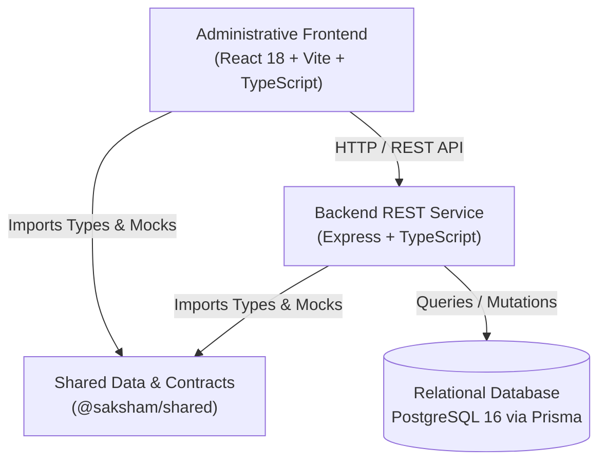
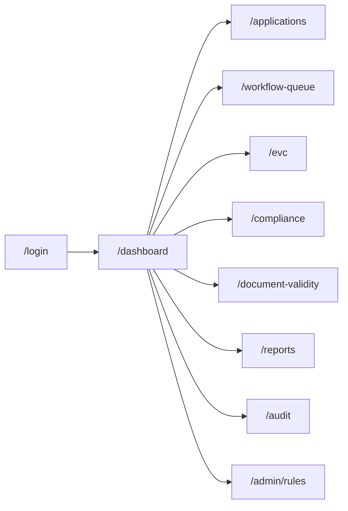

# SAKSHAM — System Implementation Walkthrough

> **Tagline:** Intelligent Scrutiny. Automated Workflows. Transparent Compliance.  
> **Statutory Basis:** AICTE Approval Process Handbook (APH) 2024–25 to 2026–27  
> **Problem Statement:** Smart India Hackathon (SIH) 26262  
> **Current Milestone:** Phase 1 — Government-Grade Administrative Portal & Core Workflows

---

## 1. System Overview & Architecture

SAKSHAM is an administrative workflow automation and compliance monitoring platform engineered for AICTE headquarters, regional offices, scrutiny officers, and Expert Visit Committees (EVC). 

### Cardinal Regulatory Guardrail
> **IMPORTANT:**
> SAKSHAM assists, guides, and accelerates authorized human officers in scrutiny, document validation, and committee evaluations. **The system does NOT and shall NEVER autonomously grant regulatory approval or issue Letters of Approval (LoA).**

### High-Level System Architecture



---

## 2. Implemented Routes & User Workflows

SAKSHAM features 10 fully implemented administrative routes with deep statutory alignment:



### Route Directory & Features

| Route | Page Component | Primary Statutory Functionality |
| :--- | :--- | :--- |
| **`/login`** | `client/src/pages/LoginPage.tsx` | Administrative sign-in with a **Development Persona Simulator** allowing instant switching between *Member Secretary*, *Regional Officer*, *Scrutiny Officer*, and *EVC Convener*. |
| **`/dashboard`** | `client/src/pages/DashboardPage.tsx` | Unified executive dashboard with synchronized metrics, regional workload breakdowns, recent applications, urgent SLA queues, and court-mandated calendar status. |
| **`/applications`** | `client/src/pages/ApplicationsPage.tsx` | Master application registry with multi-parameter filtering (by application type, stage, region, search query) and deep-dive drawer inspection. |
| **`/workflow-queue`** | `client/src/pages/WorkflowQueuePage.tsx` | Scrutiny and Re-Scrutiny queues featuring SLA ageing indicators with visual alerts for applications breaching the 7-day review threshold. |
| **`/evc`** | `client/src/pages/EVCManagementPage.tsx` | Expert Visit Committee manager tracking pending visits, team compositions, and an active **48-hour countdown** for report submissions post-inspection. |
| **`/compliance`** | `client/src/pages/CompliancePage.tsx` | Institutional undertaking tracker monitoring time-bound deficiency rectifications for 30-day, 60-day, and 90-day conditional approvals. |
| **`/document-validity`** | `client/src/pages/DocumentValidityPage.tsx` | Expiry and tenure monitor for statutory documents (Land lease tenure &ge;30 years, Fire Safety NOC renewals, and NBA/NAAC accreditations). |
| **`/reports`** | `client/src/pages/ReportsPage.tsx` | Statistical analytics and interactive visualizations (Recharts) covering regional processing volume, SLA adherence, and stage breakdown. |
| **`/audit`** | `client/src/pages/AuditPage.tsx` | Tamper-evident forensic audit ledger tracking every officer decision, state change, timestamp, and user IP address. |
| **`/admin/rules`** | `client/src/pages/AdminRulesPage.tsx` | Versioned regulatory rules engine citing exact APH clauses (e.g., minimum land requirement, built-up area per student, FSR norms). |

---

## 3. Specialized Feature Components

### 1. Statutory Approval Calendar Stepper
* **File:** `client/src/components/features/StatutoryCalendarStepper.tsx`
* **Function:** Visualizes the legally mandated timeline established under Supreme Court directives:
  1. Application Submission Window (Feb 1 – Feb 28)
  2. First Scrutiny & Deficiency Communication (Mar 1 – Mar 20)
  3. Re-Scrutiny & EVC Inspection (Mar 21 – Apr 15)
  4. Standing Hearing Committee / SAC Appeals (Apr 16 – Apr 30)
  5. Final LoA / LoR Issuance Cutoff (Strict deadline: June 10)

### 2. Scrutiny Evaluation Modal
* **File:** `client/src/components/features/ScrutinyEvaluationModal.tsx`
* **Function:** Interactive interface for scrutiny officers to evaluate institutions against APH requirements clause-by-clause:
  * Land title and lease verification (&ge; 30 years contiguous).
  * Built-up area check against sanction plans.
  * Essential amenities and barrier-free access for disabled persons.
  * Formulate official deficiency memos or recommend advancement to EVC.

### 3. Regional Jurisdiction Hub
* **File:** `client/src/components/features/RegionalJurisdictionHub.tsx`
* **Function:** Multi-region performance and workload distribution console:
  * Northern, North-Western, Western, Central, Eastern, Southern, South-Western regional offices.
  * Displays active applications, pending scrutinies, and regional SLA health.

### 4. Global Command Palette
* **File:** `client/src/components/features/CommandPalette.tsx`
* **Function:** Accessible via `Ctrl + K` or `Cmd + K`, enables keyboard-driven navigation across all 10 sections, fast search of institutions by ID or name, and immediate role switching.

### 5. Application Detail Drawer
* **File:** `client/src/components/ui/ApplicationDetailDrawer.tsx`
* **Function:** High-density slide-over drawer showing comprehensive application records: program details, sanctioned intake, verified infrastructure, flagged deficiencies, and historical audit timeline.

### 6. Government Administrative Shell
* **File:** `client/src/components/layout/AppLayout.tsx`
* **Function:** Standardized government-grade layout with:
  * Ashok Stambh emblem branding and official typography.
  * Real-time statutory operational clock and active role indicator.
  * Breadcrumb navigation and dynamic alert badges.
  * Collapsible sidebar with role-aware route highlighting.

---

## 4. Backend & Database Architecture

### REST API Endpoints (`server/src/routes/`)
* **Health Probes:**
  * `GET /api/health`: Liveness probe returning service status and uptime seconds.
  * `GET /api/health/ready`: Readiness probe verifying database and storage connections.
* **Operational Endpoints:**
  * `GET /api/metrics`: Consolidated metrics computed across all active queues.
  * `GET /api/applications`: Full master register with query filters (`search`, `stage`, `region`).
  * `GET /api/applications/:id`: Granular application record.
  * `GET /api/rules`: Regulatory rule definitions mapped to APH chapters and clauses.
  * `GET /api/evc`: EVC schedule, assigned experts, and report submission status.
  * `GET /api/compliance`: 30/60/90-day conditional compliance trackers.
  * `GET /api/documents`: Statutory document tenure and expiration records.
  * `GET /api/audit`: Tamper-evident regulatory audit trail.

### Database Relational Schema (`server/prisma/schema.prisma`)
The system schema models the complete AICTE regulatory domain:
* `Institution`: Permanent ID, name, address, minority status, contact details.
* `Application`: Application number, academic year, approval type, current stage, fee status.
* `ScrutinyRecord`: Scrutiny type, committee recommendation, verified parameters, deficiency memo.
* `EVCVisit`: Inspection dates, committee members, video evidence URL, GPS coordinates, 48h deadline.
* `ComplianceItem`: Specific deficiency, time limit (30/60/90 days), compliance proof, status.
* `DocumentItem`: Document category, issue date, expiry date, issuing authority, verification status.
* `AuditLog`: Action, officer ID, officer role, IP address, stage before, stage after, metadata.
* `RegulatoryRule`: APH clause reference, rule category, threshold, unit of measurement, effective year.

---

## 5. Shared Layer & Synthetic Dataset (`shared/src/`)

* **Data Contracts (`index.ts`):** TypeScript types, enums for stages (`SCRUTINY`, `RE_SCRUTINY`, `EVC`, `SAC`, `APPROVED`, etc.), regions, application types, and committee recommendations.
* **Deterministic Mock Data (`mockData.ts`):** 
  * Comprehensive synthetic data representing Indian engineering, pharmacy, polytechnic, and management institutions.
  * Realistic scenarios: compliant applications, 7-day SLA breached files, critical land tenure deficiencies, pending EVC visits, and compliance undertakings.

---

## 6. Statutory Documentation (`docs/`)

The repository includes a comprehensive set of official governance documents:
1. `docs/PROJECT_CHARTER.md`: Formal mandate, problem statement boundaries, and the human-in-the-loop statutory guardrail.
2. `docs/ARCHITECTURE.md`: Multi-tier architecture, data flow diagrams, and state machine transitions.
3. `docs/SOURCE_REGISTER.md`: Official citations to AICTE APH clauses, Supreme Court rulings, and gazette notifications.
4. `docs/REGULATORY_RULES_REGISTER.md`: Mathematical formulas and thresholds for land, built-up space, faculty ratios, and corpus funds.
5. `docs/IMPLEMENTATION_ROADMAP.md`: Phased development roadmap from Phase 1 through Phase 5.

---

## 7. How to Run & Verify

### Running the Full Stack Concurrently
```powershell
npm run dev
```
* **Frontend:** `http://localhost:5173`
* **Backend API:** `http://localhost:5000`

### Running Workspaces Individually
* **Frontend client only:** `npm run dev:client`
* **Backend server only:** `npm run dev:server`
* **Build shared types:** `npm run build --workspace=shared`
* **Run automated test suite:** `npm test`
* **Run type check & linter:** `npm run lint`
